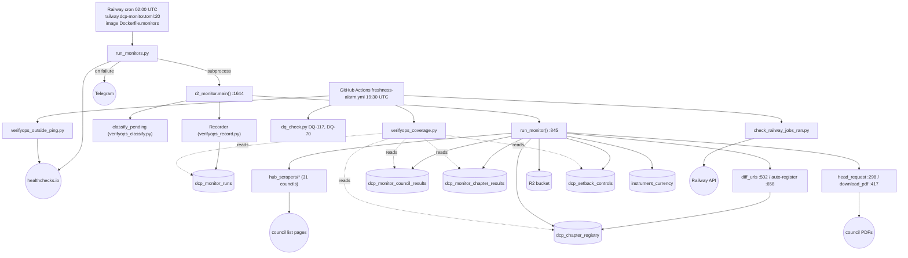

<!-- prior-art-checked: docs/qa/architecture-overview.md is system-wide and undated vs code; this is per-area, traced from code at a6d2e378. -->
# DCP monitor: how a run works

Commit `a6d2e378` (2026-10-24). Traced from the code, not from the docs. Each arrow is backed by a file:line in the list below.
Spot-checked by the main session: `r2_monitor.py:1689-1698`, `Dockerfile.monitors:30` (copies `hub_scrapers/`), `verifyops_record.py:113,142,147`, and the cron at `railway.dcp-monitor.toml:20`.

## Evidence (file:line)
- Scheduler: `railway.dcp-monitor.toml:20`. `run_monitors.py:32-33` maps the job to `r2_monitor.py`, `:337` runs it, `:350` pings healthchecks, `:324,358` sends Telegram on failure.
- Main: Recorder `:1689`, start `:1691`, run_monitor `:1692`, classify_pending `:1695`, finish `:1698`.
- Hub scrape `:944/956`, diff `:960`, auto-register `:1059`, a council with no scraper `:1148`.
- Per chapter: HEAD `:1189`, decide_fetch `:1235`, download `:1265`, R2 get `:1310` / put `:1373`, registry UPDATEs `:1246-1498`, setbacks `:1251,1289,1406`, instrument_currency `:600`.
- Recorder tables: `verifyops_record.py:113,142,147,161`.
- Alarm: `freshness-alarm.yml:42`, coverage step `:101`, outside ping `:130`.

## Not resolved yet (do not defend these until checked)
- Which sites each hub scraper fetches: the URLs come from `dcp_chapter_registry.council_page_url` in the DB, not from the code.
- R2 key layout (`r2_path_for_version` `:489`) has not been read.
- What DQ-117 and DQ-70 query has not been confirmed.
- The live Railway cron could differ from the toml. CI step "Railway cron matches config-as-code" checks this.
- Per the toml, dcp-extract-all is now the main change detector, not this monitor. It is not traced here.

## Observations for the review (not verdicts)
- `HUB_SCRAPERS` import falls back to `{}` on ImportError (`r2_monitor.py:48-52`). If that import ever broke, every council would be logged as "no_scraper" rather than the run failing loudly. Check this against the "fail loud" bar.
- `verifyops_record.py:221` imports from `hub_scrapers.inner_west`, a council-specific module, into the generic recorder. Possible layering issue.
- `Dockerfile.monitors` copies around 70 files one by one for one image that serves many jobs. Its own comments record past ImportErrors from a missed COPY.
