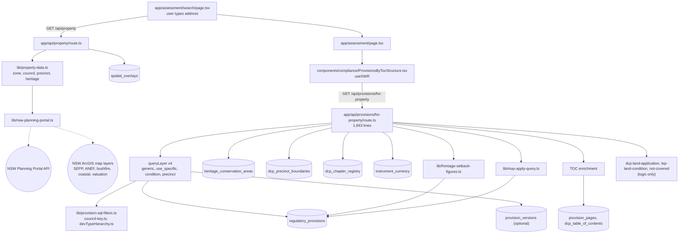

<!-- prior-art-checked: docs/qa/architecture-overview.md is system-wide and undated vs code; this is per-area, traced from code at a6d2e378. -->
# Address in, rules out: the served-rules path

Commit `a6d2e378` (2026-10-24). Traced from the code, not from the docs. Paths are relative to `frontend-nextjs/`.
Spot-checked by the main session: the 4 `queryLayer` calls at `route.ts:407/417/427/437`, the function at `:1016`, and no `fetch(` in `route.ts`.

**Key fact:** serving rules is all Next.js reading Postgres directly through `lib/db.ts`. No Python service is called on this path.
Python's job is offline: it writes the `v2_*` columns that this code filters on.

## Evidence (file:line)
- Search to property: `app/assessment/search/page.tsx:29`, `hooks/usePropertyAssessment.ts:175-178`, `app/api/property/route.ts:48` (`spatial_overlays` at `:81`).
- Portal: `lib/property-data.ts:129`. External URLs at `lib/nsw-planning-portal.ts:472,473,701,705,1269-1316`.
- Component: mounted at `app/assessment/page.tsx:638-641`. Request at `ProvisionsByTocStructure.tsx:413`; no request is made while the council is empty. Params built in `lib/dcp-provisions-query.ts`.
- Route: `GET` `:284`, council key `:330`, land application `:350`, layers `:407-437`, `queryLayer` `:1016`, main SQL `:1097` (`is_current`, `v2_dcp_layer`, `source_council`, zone/heritage/dev-type/precinct filters `:1136-1260`).
- Other tables: heritage `:182,201,867`, precinct boundaries `:529`, chapter registry `:557`, instrument currency `:607`, TOC `:929-985,1366-1401`, setbacks `frontage-setback-figures.ts:112,117`, may-apply `may-apply-query.ts:66`.
- Other callers of this route: `app/api/assessment/full/route.ts` and `lib/ai/router.ts`.

## Not resolved yet (do not defend until checked)
- Which Python code writes the `v2_*` columns that this code filters on. That is the enrichment pipeline; this path only reads them.
- The external host list comes from grepping URL literals, so it may be incomplete (`greenweb-overlay`, classified-road and rail-busy-road modules not read).
- Whether `lep-land-condition.ts` and `dcp-land-application.ts` touch the DB has not been confirmed.

## Observations for the review (not verdicts)
- `for-property/route.ts` is **1,663 lines**, more than 3x the 500-line house rule, and it sits on the most important path. `lib/nsw-planning-portal.ts` is 1,457 lines.
- The route mixes HTTP handling, SQL building and result shaping in one file, which makes it hard to test pieces alone.
- SQL filters are built by hand-assembled strings and params. Check they are all parameterised (security bar).
- `app/api/assessment/full/route.ts` calls this route with an HTTP `fetch` to its own server, rather than calling a shared function.
